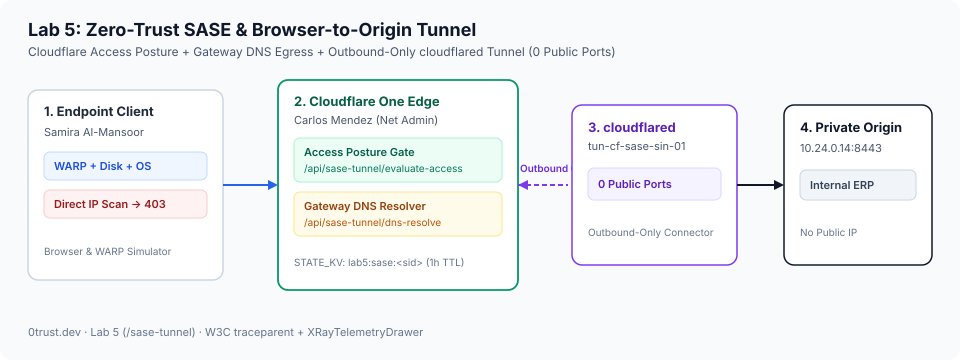

# Architecture: Zero-Trust SASE & Browser-to-Origin Tunnel (`0trust-lab-sase-tunnel`)

> **Standalone Route**: `https://lab.0trust.dev/sase-tunnel`
> **Local Dev Port**: `5180` (`preview`: `4180`; local Hono API on `127.0.0.1:8080`)
> **Hosting Split**: Static SPA (`dist/`) on **Cloudflare Pages** + API (`/api/sase-tunnel/*`) on **GCP Cloud Run** (`0trust-lab-sase-tunnel`, `min_instance_count = 0`) fronted by `0trust-lab-router`
> **State Backend**: **Firestore Native** (`kv_state` collection, doc ID `sase-tunnel:<encodeURIComponent(key)>`, `lab5:sase:` prefix, 1-hour TTL with synchronous `expireAt` enforcement; `MemoryKvAdapter` local fallback)

## System Overview

Lab 5 models a Cloudflare One Zero-Trust SASE deployment that eliminates legacy VPNs and public origin IP exposure:

1. **AppShell Header, `driver.js` Orientation & Dropdown Role Switcher (`remote-employee` ↔ `net-admin`)**:
   - Compact sticky `56px` AppShell header with `All Labs`, lab title, live status pill, dropdown `RoleSwitcherBar` (with notification dots for pending policy hardening or verification), `Lab Tour` (`driver.js` orientation overlay), and `Reset`.
   - **Remote Staff (`Samira Al-Mansoor`)**: Corporate Browser & Internal App Portal simulating 3 endpoint posture profiles (`managed-corp`, `unmanaged-byod`, `stale-os`), internal app tunnel launches (`Internal ERP`, `Finance Ledger`, `SSH Bastion`), and Gateway DNS lookups with strict role isolation.
   - **Network Security (`Carlos Mendez`)**: Access & Tunnel Policy console managing Cloudflare Access posture rules, Gateway DNS egress sinkholes, active `cloudflared` connector telemetry, and recent DNS query logs.
   - Static SPA (`dist/`) is served from Cloudflare Pages via `0trust-lab-router` at `https://lab.0trust.dev/sase-tunnel`.
2. **Same-Origin Routing & Cloud Run API (`server/app.ts` → synced `server/runtime.ts`, canonical `Dockerfile`)**:
   - `server/app.ts` is a thin lab-specific route wrapper calling `createBaseLabApp` from the canonical synced `server/runtime.ts` (synced from `0trust.dev/templates/lab-runtime/` alongside `server/kvAdapter.ts`, `server/origin.ts`, `server/index.ts`, and the canonical multi-stage `Dockerfile`).
   - `0trust-lab-router` forwards `/api/sase-tunnel/*` and `/sase-tunnel/api/*` to the GCP Cloud Run origin with `X-Forwarded-Host`, `X-Forwarded-Proto`, and `X-Lab-Router-Secret`.
   - Cloud Run enforces fail-closed constant-time `X-Lab-Router-Secret` validation on all `/api/*` routes (`403 FORBIDDEN_DIRECT_ORIGIN` on direct `*.run.app` calls), while exposing `GET /healthz` (`200 { ok: true, lab: "sase-tunnel" }`) for Cloud Run probes.
   - `GET /api/sase-tunnel/health`: Returns service health for frontend capability detection.
   - `POST /api/sase-tunnel/evaluate-access`: Enforces device posture gates (`require_warp`, `require_disk_encryption`, `require_min_os`), fails closed (`403 CF_ACCESS_POSTURE_DENIED`) on posture failure, fails closed (`403 ORIGIN_NO_PUBLIC_INGRESS`) on direct-to-origin probes, and mints synthetic `cf-access-jwt-assertion` claims when compliant.
   - `POST /api/sase-tunnel/dns-resolve`: Evaluates outbound DNS queries against an allowlisted preset catalog (`CORPORATE_INTERNAL`, `APPROVED_SAAS`, `SHADOW_AI_GENAI`, `COMMAND_AND_CONTROL`, `MALWARE`) and sinkholes blocked categories to `NXDOMAIN` (`0.0.0.0`, HTTP `403`).
3. **`cloudflared` Outbound-Only Tunnel & Private Origin**:
   - Connector `tun-cf-sase-sin-01` dials outbound QUIC to Cloudflare Edge (`SIN`), exposing `0` public inbound ports on private origin `10.24.0.14`.
4. **State, Observability & Terraform Backend (`server/kvAdapter.ts`, `functions/api/_middleware.ts`, `_telemetry.ts`, `infra/terraform/backend.tf`)**:
   - `FirestoreKvAdapter` stores session state in Firestore Native (`kv_state`) with document IDs scoped to `sase-tunnel:<encodeURIComponent(key)>` and synchronous `expireAt.toMillis() <= Date.now()` expiry checks; local `npm run dev` uses `MemoryKvAdapter` with zero GCP credentials required.
   - Propagates W3C `traceparent`, sanitizes `X-Session-Id`, redacts JWT signatures (never logging `X-Lab-Router-Secret` or `OTLP_AUTH_HEADER`), sets `X-Edge-Latency-Ms`, injects `_telemetry` into JSON responses for the `XRayTelemetryDrawer` (including a `Global Live Dashboard ↗` link to `https://0trust.dev/observability`), and exports non-blocking OTLP `/v1/traces` + `/v1/logs` with `OTEL_SERVICE_NAME=zerotrust-lab-sase-tunnel` authenticated via GCP Secret Manager `grafana-otlp-auth-header` (`OTLP_AUTH_HEADER`).
   - Provisioned via `infra/terraform/` (`managed-infrastructure//modules/cloudflare-pages-lab` + `managed-infrastructure//modules/cloud-run-lab`) and deployed via split GitHub Actions jobs (`deploy-pages` + WIF OIDC `deploy-cloudrun`). Remote GCS state is declared in `infra/terraform/backend.tf` (`bucket = "0trust-dev-tfstate"`, `prefix = "labs/sase-tunnel"`), with `.terraform/` and `*.tfstate*` gitignored. Operators migrating from local state should provision the GCS bucket once (Uniform Bucket-Level Access, versioning enabled, `public_access_prevention = "enforced"`) and run `terraform init -migrate-state`.
